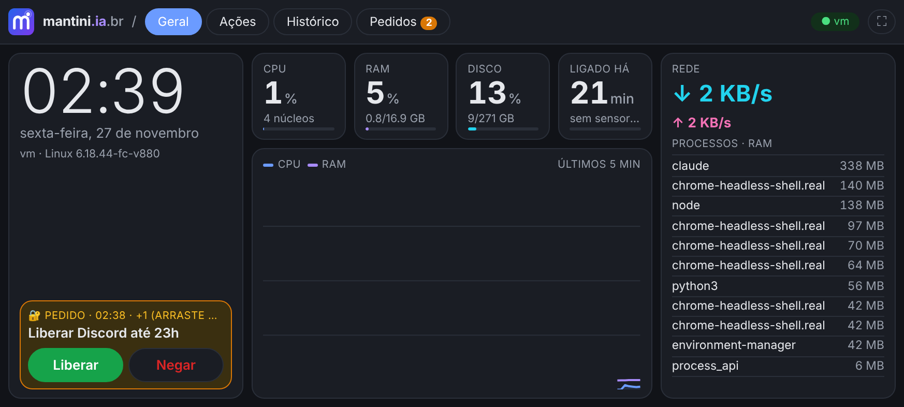
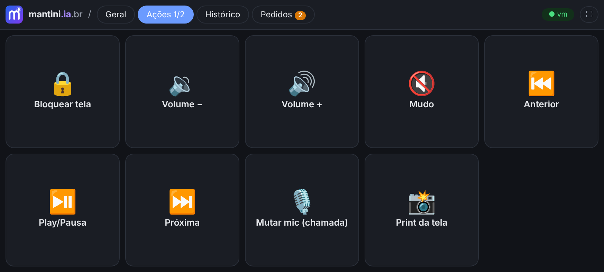

# 📱 Painel de Controle (PC → celular)

Transforma o celular (ex.: Redmi Note 10S) num painel que:

- **mostra dados do PC** em tempo real: CPU, RAM, disco, rede, tempo ligado, temperatura/bateria e processos;
- **recebe notificações** no celular (pelo app gratuito **ntfy**), mesmo com a tela desligada;
- **libera ou nega pedidos** com um toque, direto na notificação ou no painel;
- **executa ações** cadastradas por você (bloquear tela, desligar etc.);
- **avisa** quando CPU, RAM ou disco passam do limite.

Usa o visual do **mantini.ia.br** (tema claro ou escuro, segue o do celular).
Feito para o celular **deitado**: tudo cabe na tela, sem rolar. O que não couber vira outra tela,
e você troca **arrastando para o lado** ou tocando nas abas do topo (Geral → Ações → Histórico → Pedidos).




## 1. No PC

Precisa de Python 3.10 ou mais novo.

**Jeito fácil (Windows):** dê dois cliques em **`iniciar-painel.bat`**. Ele atualiza o painel, instala o que
faltar e deixa o painel rodando (se cair, ele religa sozinho). Para o painel **iniciar junto com o Windows**,
dê dois cliques em **`instalar-inicio-automatico.bat`**; para desfazer, use `remover-inicio-automatico.bat`.

**Pelo terminal:**

```bash
cd painel
pip install -r requirements.txt
python servidor.py
```

Na primeira vez ele cria o `config.json` com um **token secreto** e mostra algo assim:

```
No celular, abra:  http://192.168.0.10:8765/?token=AbC123...
Tópico ntfy:       painel-1a2b3c4d5e6f
```

> No Windows, aceite o aviso do Firewall para **redes privadas**.

## 2. No celular

1. Conecte no **mesmo Wi-Fi** do PC.
2. No PC, abra **http://localhost:8765/qr** e aponte a câmera do celular para o QR code.
   Ou digite no **Chrome** do celular o link mostrado no terminal.
3. Menu ⋮ → **Adicionar à tela inicial**. Ele vira um app em tela cheia.

### Notificações com botões "Liberar / Negar"

1. Instale o **ntfy** (Play Store ou F-Droid).
2. Toque em **+** e inscreva-se no tópico mostrado no terminal (ex.: `painel-1a2b3c4d5e6f`).
3. No `config.json`, preencha `url_publica` com o endereço do PC visto pelo celular,
   por exemplo `"http://192.168.0.10:8765"`, e reinicie o servidor.

> **MIUI:** em *Configurações → Apps → ntfy*, deixe a **Economia de bateria** em *Sem restrições*
> e ative o **Início automático**. Sem isso a MIUI corta as notificações.

## 3. Pedir liberação a partir de qualquer script

```bash
python pedir.py "Liberar internet do PC" "Pedido às 21h"
```

O script fica esperando você tocar em **Liberar** ou **Negar** no celular. Códigos de saída:
`0` = liberado, `1` = negado, `2` = sem resposta (padrão: 300 s, mude com o 3º argumento).

Isso permite encadear com outros comandos:

```bat
python pedir.py "Rodar backup grande" && backup.bat
```

Outros programas também podem pedir liberação via HTTP:

```
POST /api/pedidos            {"titulo": "...", "detalhe": "..."}
GET  /api/pedidos/{id}/aguardar?timeout=60
Cabeçalho: Authorization: Bearer <token>
```

## 4. Cadastrar ações

No `config.json`, em `"acoes"`, cada item vira um botão no painel. Já vêm prontas (Windows): bloquear tela,
volume −/+, mudo, anterior/play/próxima, mutar mic em chamadas (Win+Alt+K), print, recortar tela,
mostrar área de trabalho, explorador, gerenciador de tarefas, calculadora, suspender, reiniciar,
desligar e cancelar. Quem tinha um `config.json` antigo recebe as ações novas automaticamente.

Uma ação pode rodar um **comando** ou apertar **teclas de atalho**:

```json
"abrir_obs":   { "nome": "🎬 OBS",            "comando": ["cmd", "/c", "start", "", "obs64.exe"] },
"gravar_obs":  { "nome": "🔴 Gravar",         "teclas": ["ctrl", "shift", "f9"] },
"fechar_janela": { "nome": "✖️ Fechar janela", "teclas": ["alt", "f4"], "confirmar": true }
```

Teclas aceitas: letras e números, `win`, `ctrl`, `shift`, `alt`, `tab`, `esc`, `enter`, `espaco`,
`printscreen`, `delete`, `f1`…`f12`, `volume_mais`, `volume_menos`, `volume_mudo`, `play_pausa`,
`proxima`, `anterior`, `parar`. O emoji no começo do nome vira o ícone do botão. Reinicie o painel depois de editar.

```json
"abrir_spotify": {
  "nome": "🎵 Spotify",
  "comando": ["cmd", "/c", "start", "spotify:"]
}
```

Use `"confirmar": true` para pedir confirmação antes de executar.
**Só rodam os comandos que estão no arquivo**: o celular não envia comandos livres.

## 5. Conectar por Bluetooth (sem Wi-Fi)

O celular cria uma pequena rede por Bluetooth (**ancoragem Bluetooth**) e o painel funciona igual.

1. **Pareie** o celular com o PC (Configurações de Bluetooth do Windows → Adicionar dispositivo).
2. **No Redmi:** *Configurações → Conexão e compartilhamento → Ancoragem Bluetooth* → **ativar**.
3. **No Windows:** Painel de Controle → *Dispositivos e Impressoras* → botão direito no celular →
   **Conectar usando → Ponto de acesso**.
   (No Linux: `bluetoothctl` + `nmcli device connect <MAC-do-celular>`.)
4. Rode `python servidor.py`. O link marcado `<- Bluetooth` (geralmente `192.168.44.x`) é o que você
   abre no celular. Use esse mesmo endereço no `url_publica`.
5. **Firewall do Windows:** a rede Bluetooth costuma entrar como "Pública". Libere o Python também
   em redes públicas, ou mude o perfil dessa rede para *Privada*.

Observações:
- O Bluetooth é lento (cerca de 1 a 2 Mbps), mas sobra para o painel. O alcance é de uns 10 metros.
- Com a ancoragem ligada, o PC pode passar a usar os **dados móveis** do celular para a internet.
  Se o PC também estiver no Wi-Fi ou no cabo, o Windows costuma continuar preferindo essas conexões.
  Para garantir que o celular não tenha internet para compartilhar, desligue os dados móveis.
- O painel funciona mesmo **sem internet**: com ele aberto, o celular vibra quando chega pedido novo.
  Já as notificações do ntfy precisam de internet no PC e no celular.

## 6. Acessar fora de casa

Instale o **Tailscale** no PC e no celular (gratuito). Depois use o IP do Tailscale (100.x.x.x)
no link e no `url_publica`. Evite abrir a porta direto no roteador.

## 7. Iniciar junto com o Windows

Dê dois cliques em `instalar-inicio-automatico.bat`. Ele cria um atalho na pasta de inicialização do Windows
que abre o `iniciar-painel.bat` minimizado.

## Segurança

- O `token` funciona como uma senha: não compartilhe o link e não suba o `config.json`
  para o GitHub (ele já está no `.gitignore`).
- O tópico do ntfy é público para quem souber o nome. Por isso ele é gerado aleatório, e os
  botões da notificação só funcionam com o token.
- Os pedidos ficam em memória e somem quando o servidor reinicia.
